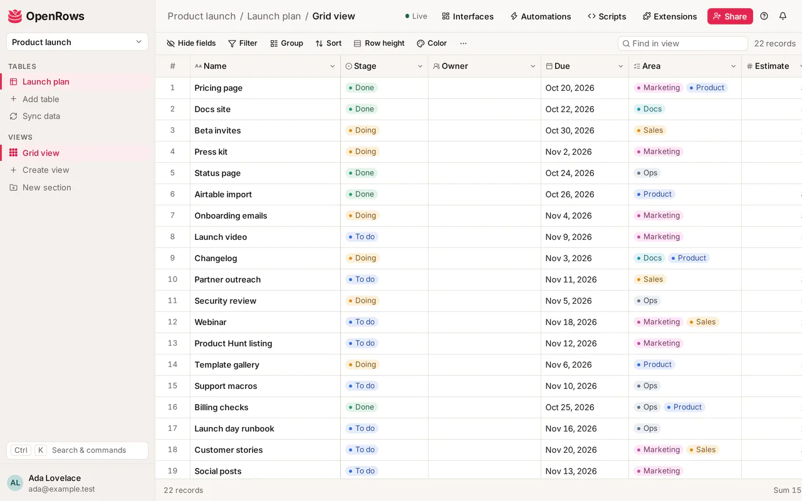

<p align="center">
  
</p>

<h1 align="center">OpenRows</h1>

<p align="center">
  <strong>The open-source Airtable alternative: a relational database with a spreadsheet's ease, that you can host yourself.</strong>
</p>

<p align="center">
  <a href="LICENSE"></a>
  <a href="https://github.com/Draggable/openrows/releases/latest"></a>
  <a href="https://www.npmjs.com/package/@openrows/sdk"></a>
</p>

<p align="center">
  <a href="https://openrows.io">Website</a> ·
  <a href="https://openrows.io/docs">Docs</a> ·
  <a href="https://app.openrows.io">Hosted app</a> ·
  <a href="docs/guide/self-hosting.md">Self-hosting</a> ·
  <a href="docs/api/v1.md">API</a>
</p>

OpenRows organizes data in workspaces, bases and tables of records with typed fields, linked
records, lookups, rollups and formulas, and shows it as a grid, kanban board, calendar, gallery,
timeline, nested list or form. Teams edit together in real time, automate their work, build
interfaces on top of their data and connect it to other tools through a REST API in Airtable's
shape. Run it on your own server with Docker Compose or Kubernetes, or use the hosted service at
[app.openrows.io](https://app.openrows.io).



## Features

Everything below is in this repository, under the AGPL-3.0.

**Data and views**

- Workspaces, bases and tables, each table stored as its own Postgres table.
- 30 field types: text, long text with rich formatting, numbers, currency, percent,
  duration, rating, dates and times, single and multiple select, checkbox, email, URL, phone,
  barcode, attachments, users, buttons, auto numbers, created/modified time and by, and AI fields.
- Linked records, lookups, rollups, counts and a formula language with an editor that completes,
  type-checks and previews as you write.
- Grid (virtualized, with copy/paste, fill and undo), kanban, calendar, gallery, timeline (Gantt,
  with dependencies), list (nested by a self link) and form views, each with filters, sorts,
  groups, row colors and hidden fields; personal and locked views.
- Interfaces: pages built from a base's data (record lists, record review, dashboards with numbers
  and charts, forms, boards, calendars and timelines), with interface-only collaborators.
- CSV import and export, base and account exports (ZIP), base snapshots and restore, duplicate a
  base, a 30-day trash, record revision history, and 10 built-in templates plus "Save as template".
- Import from Airtable: schema, records, links, attachments and views, with a report of what
  changed on the way ([guide](docs/guide/airtable-migration.md)).

**Collaboration and sharing**

- Real-time editing with presence (who is on the view, their selected cell).
- Roles per workspace and base (owner, creator, editor, commenter, read-only), plus edit
  permissions per table and field.
- Record comments with @mentions and reactions, in-app and email notifications with digests.
- Share links for views and whole bases (optional password and email-domain limits), embeds, and
  public forms with conditional fields and Cloudflare Turnstile.
- An installable web app (PWA) with phone layouts and a per-user offline read cache.

**Automation and extensibility**

- Automations: triggers on records created, updated or matching a condition, schedules, form
  submissions, incoming webhooks and button clicks; actions that create, update and find records,
  send email, HTTP requests and Slack messages, and (opt-in) run scripts in a locked-down
  container. A visual builder with test runs and run history.
- Scripts that run against a base in a sandboxed browser worker.
- Extensions: a panel of sandboxed apps beside your views (chart, print view and URL preview are
  built in), written with the [`@openrows/blocks`](packages/blocks/README.md) SDK.
- Synced tables from another base or view, a CSV URL, or a Postgres table or query.
- AI fields and an AI assistant that drafts tables, fields, formulas, views and automations and
  applies only what you confirm. They work with any OpenAI-compatible provider (OpenAI,
  Anthropic's compatible endpoint, OpenRouter, a local Ollama): the instance's own, or a key each
  workspace owner brings.

**API and integrations**

- REST API v1 in the shape of Airtable's Web API (`typecast`, upserts, `filterByFormula`), with an
  OpenAPI document and a reference page in the app ([docs/api/v1.md](docs/api/v1.md)).
- Personal access tokens with scopes and per-base grants, OAuth apps with PKCE
  ([docs/api/oauth.md](docs/api/oauth.md)), per-token and per-base rate limits.
- Webhooks with signed, retried deliveries and a delivery log
  ([docs/api/webhooks.md](docs/api/webhooks.md)).
- A remote MCP endpoint at `/mcp` and a stdio MCP server for AI agents
  ([docs/api/mcp.md](docs/api/mcp.md)).
- Packages in this repository: the typed JavaScript SDK
  ([`@openrows/sdk`](packages/sdk/README.md)), the MCP server
  ([`@openrows/mcp-server`](packages/mcp-server/README.md)), n8n community nodes
  ([`@openrows/n8n-nodes-openrows`](packages/n8n-nodes-openrows/README.md)) and the extensions SDK
  ([`@openrows/blocks`](packages/blocks/README.md)).

**Operations**

- One Docker image for the api, the background worker and the migrations; a Helm chart for
  Kubernetes ([deploy/helm/openrows](deploy/helm/openrows/README.md)).
- Sign-in through any OpenID Connect provider (Keycloak config included), Postgres row-level
  security behind the app's own authorization, an SSRF-safe client for every user-chosen URL,
  optional ClamAV scanning of uploads.

A self-hosted server has no plans, quotas or billing: every workspace is unlimited.

### Hosted-only features

The hosted service adds features that are **not in this repository** and aren't open source:
per-workspace SAML and OIDC single sign-on with domain verification, SCIM 2.0 provisioning, the
workspace audit log with export and a SIEM stream, the workspace admin console and its policies,
data residency, billing and plans, AI credits on a hosted model (no key needed), Google Sheets
synced tables, and the Zapier and Make apps. A self-hosted server signs everyone in through its
own OIDC provider (which can broker SAML, Google, GitHub and others), and connects to other tools
through the REST API, webhooks and the n8n nodes.

## Self-hosting

You need Docker with Compose v2 (or a Kubernetes cluster), an OpenID Connect provider that issues
verified emails, an S3-compatible bucket and a public https name. The
[self-hosting guide](docs/guide/self-hosting.md) covers each setting, sign-in, storage, email,
backups, upgrades and security.

### Try it locally

The development stack needs no configuration. It runs Postgres, the migrations, the api, the
worker, Keycloak with a ready realm, Mailpit and an S3 server on 127.0.0.1:

```sh
git clone https://github.com/Draggable/openrows.git && cd openrows
docker/compose.sh dev up -d --wait
```

Open http://localhost:8180 and sign in as `dev@openrows.test` with the password
`openrows-dev-password`; mail lands in Mailpit at http://localhost:8025.
`docker/compose.sh dev down -v` stops it and drops its data. This stack uses well-known secrets:
never expose it.

### Production with Docker Compose

Use the base file [docker/compose.yml](docker/compose.yml) (postgres, migrate, api, worker) with
the overlay [docker/selfhost.yml](docker/selfhost.yml), which publishes the api on loopback for
your reverse proxy (optional profiles: Keycloak, ClamAV, Valkey), and an env file outside the
checkout made from [docker/.env.selfhost.example](docker/.env.selfhost.example): `APP_URL`,
`ENCRYPTION_KEY`, the `PG_*` and `OPENROWS_APP_DB_PASSWORD` database settings, `OIDC_*`, `S3_*`
and optionally `SMTP_*` ([.env.example](.env.example) lists every variable). Then:

```sh
c="docker compose -p openrows -f docker/compose.yml -f docker/selfhost.yml --env-file /srv/openrows/.env"
$c build
$c up -d --wait
```

`up` runs the migrations first, then starts the api and the worker. In production the server
refuses to start with a missing, default or placeholder secret, an http `APP_URL`, or a database
role that bypasses row-level security. Upgrading is `git pull`, `$c build`, `$c up -d --wait`.
The guide's [production stack](docs/guide/self-hosting.md#a-production-stack) section has the
details.

### Kubernetes with Helm

The chart in [deploy/helm/openrows](deploy/helm/openrows/README.md) runs the api, the worker and
a migrations Job (a pre-upgrade hook on upgrades), with an optional bundled Postgres, Valkey and
Ingress. It reads secrets only from a Secret you create and refuses to render without an image
tag, `appUrl`, `existingSecret`, the OIDC issuer and the bucket:

```sh
helm install openrows ./deploy/helm/openrows -n openrows -f openrows-values.yaml --wait --timeout 10m
helm test openrows -n openrows
```

See [Kubernetes (Helm)](docs/guide/self-hosting.md#kubernetes-helm) for the Secret's keys and a
values file.

## Hosted version

[app.openrows.io](https://app.openrows.io) runs the same core, operated by Draggable, plus the
hosted-only features above. Prices are per editor per month; paying annually gets two months free.

| Plan | Monthly | Annually | Highlights |
| --- | --- | --- | --- |
| Free | $0 | $0 | Up to 5 editors, 1,000 records per base, 1 GB of attachments |
| Pro | $10 | $100 | 50,000 records per base, personal and locked views, edit permissions |
| Business | $24 | $240 | 250,000 records per base, single sign-on and SCIM |
| Enterprise | Custom | Custom | Audit log export, admin console, data residency |

Full limits and the plan comparison: [openrows.io/pricing](https://openrows.io/pricing).

## Development

You need Node 22 (22.12 or later; `nvm use` reads `.nvmrc`), npm (the only supported package
manager) and Docker with Compose v2 for the services and the integration tests.

```sh
npm ci                                  # install, plus the git hooks
docker/compose.sh dev up -d --wait postgres keycloak mailpit s3
npm run build -w @openrows/shared       # the server and client import its build
npm run db:migrate                      # apply the migrations
npm run dev                             # server on :3000, client on http://localhost:5173
```

To sign in from `npm run dev`, export the `OIDC_*` values from the authentication
section of [.env.example](.env.example) first (the server doesn't read `.env` files); without them
`/auth/login` answers 503. `npm run db:seed -- --email dev@openrows.test` then gives that user
(once signed in) a demo base with 2,000 records.

| Command | What it does |
| --- | --- |
| `npm run build` | Builds every package (`tsc -b`, and Vite for the client) |
| `npm run typecheck` | Type-checks every package, tests included |
| `npm run lint` | Biome lint and format check, plus the brand-name check |
| `npm test` | Unit tests (Vitest) |
| `npm run test:integration` | Server tests against a real Postgres 16 (needs a Docker daemon) |
| `npm run e2e` | Playwright tests against the built app (`npm run build` first) |
| `npm run db:generate` / `npm run db:check` | Create a migration from the schema / check they agree |

The stack is TypeScript end to end: a [Hono](https://hono.dev) server with Drizzle ORM on
PostgreSQL 16 and [pg-boss](https://github.com/timgit/pg-boss) jobs, a React 19 client with
Vite, TanStack Router and Query and Tailwind 4, and Zod contracts shared by both.
[docker/README.md](docker/README.md) describes the image and the Compose stacks, and
[CONTRIBUTING.md](CONTRIBUTING.md) the conventions and checks.

## Documentation

- [docs/](docs/README.md): the index of everything below
- [User guide](docs/guide/getting-started.md), also at [openrows.io/docs](https://openrows.io/docs)
- [Self-hosting](docs/guide/self-hosting.md) and [moving from Airtable](docs/guide/airtable-migration.md)
- API: [REST API v1](docs/api/v1.md), [webhooks](docs/api/webhooks.md),
  [OAuth apps](docs/api/oauth.md), [MCP](docs/api/mcp.md); every server also serves its OpenAPI
  document at `/api/openapi.json`, a reference at `/docs/api` and an [llms.txt](https://app.openrows.io/llms.txt)
  for AI agents
- [Architecture decision records](docs/adr/README.md)

## Contributing

Bug reports, feature requests and pull requests are welcome. Read
[CONTRIBUTING.md](CONTRIBUTING.md) first; for anything larger than a small fix, open an issue to
agree on the change before you write it.

## Security

Please report vulnerabilities privately, never in a public issue. See [SECURITY.md](SECURITY.md).

## License

Everything in this repository is licensed under the
[GNU Affero General Public License v3.0 only](LICENSE) (`AGPL-3.0-only`). If you run a modified
version as a network service, the AGPL requires you to offer its users the source of your
version.

The hosted-only features of [app.openrows.io](https://app.openrows.io) are proprietary and live
outside this repository.

"OpenRows" and the rose logo are trademarks of Draggable. The license grants no rights to them;
[TRADEMARKS.md](TRADEMARKS.md) explains what is fine and what isn't.
