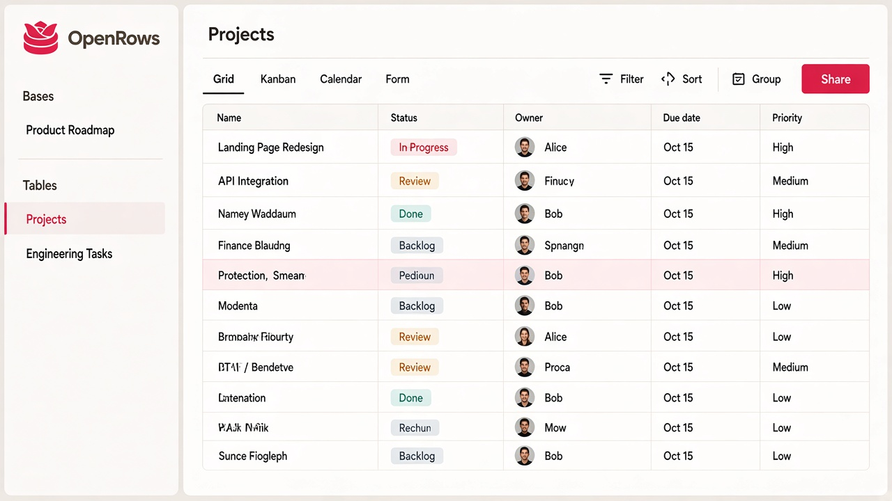

# OpenRows design direction: "Ledger"

Status: v0.2 (2026-10-28). Owner: product. v0.1 (2026-10-25) set the Ledger direction for M1 and M2; v0.2 keeps its density, type and layout and replaces the green brand with the rose logo.
Mockups are AI-generated references for direction, not pixel specs (ignore their text). When a mockup and this file disagree, **this file wins**.

## 1. Direction in one paragraph
OpenRows should feel like a well-kept ledger: warm paper, crisp ink, and a rose that only shows up for the brand, the one primary action of a view, focus and the active nav item, with a deep leaf green for what is selected or done. Warm neutral greys do most of the work. It is calm, not playful (Airtable's candy colours and big rounded tiles are what we deliberately move away from). It is keyboard-first: every toolbar action has a shortcut, focus is always visible, and `Ctrl/⌘ K` opens a command menu from anywhere. It is dense but readable, with 34 px rows, 13 px text, tabular numbers and hairline dividers, so a laptop screen shows 15+ rows and 8+ columns without feeling cramped.

Explored and rejected: **Graphite** (cool grey + indigo; competent but looks like every dev tool) and **Signal** (white + orange; loud, and the orange fights with status chips). See `explorations/`.

## 2. Brand
- **Name and wordmark:** "OpenRows", capital O and R, everywhere users read it: the wordmark (Inter Bold (700), tracking −1%), page titles, emails, docs. Lowercase `openrows` only where it is an identifier: domains (openrows.io), the `@openrows/` npm scope, package, CLI and container names, env vars, paths, keys. `npm run lint:brand` checks it.
- **Mark:** a rose sitting on two stacked rows ("open rose"), in rose `#E22651`. Source: [brand/logo.png](brand/logo.png); the traced vector is [brand/logo-mark.svg](brand/logo-mark.svg) (one path, 64 x 64, also `LOGO_MARK_PATH` in `@openrows/shared` and the client's `LogoMark`). In the app the mark is 22 px next to an 18 px wordmark, a little smaller than on the site and in the mockups. The favicon set, apple-touch icon, web app icons, OG images (light and dark) and the emails' mark are generated from the SVG by `node scripts/brand-assets.mjs`. The mark is always rose, on paper, charcoal or transparent; never recolour or outline it.
- **Voice:** plain, short, sentence case. "Add record", not "Create New Record".

## 3. Colour tokens
Source of truth: `packages/client/src/index.css`. Both scales are in it as `--rose-50` … `--rose-950` and `--leaf-50` … `--leaf-950`.

### Brand scales
| Step | Rose | Leaf |
|---|---|---|
| 50 | `#FFF2F3` | `#F1F7F4` |
| 100 | `#FFE5E5` | `#E2F0E9` |
| 200 | `#FFCDCF` | `#C8E3D6` |
| 300 | `#FEA7AC` | `#9ED0B8` |
| 400 | `#FF6B7D` | `#65B693` |
| **500** | **`#E22651`** (the brand, sampled from the logo) | **`#1E8C66`** |
| 600 | `#C91143` | `#17805D` |
| 700 | `#AA0536` | `#0E6B4C` |
| 800 | `#8B0B2C` | `#0F583F` |
| 900 | `#720F25` | `#104834` |
| 950 | `#470212` | `#032A1C` |

Derived in OKLCH at the base colour's hue, so the steps keep it. White text on rose-500 is 4.54:1 (AA); rose text on white uses rose-600 (5.8:1).

**Rose** is used sparingly: the logo, the one primary button of a view (`bg-brand`), focus rings and input focus borders (`--brand`, Tailwind `ring`/`brand`), and the active nav item (rose bar, `--brand-tint` petal fill, `--brand-text`). **Leaf** (the rose's complement, kept deep so it doesn't read as Christmas) is the `primary` of selected and active states: checkboxes, the selected cell and range, active toolbar buttons, checkmarks, today, progress, success. the starting point `#1E8C66` is leaf-500; the UI uses leaf-700 in light mode and leaf-400 in dark mode for contrast.

### Light (default)
| Token | Hex | Use |
|---|---|---|
| `--bg-app` | `#FAF7F5` | App background, comment panel |
| `--bg-sidebar` | `#F4F0EC` | Sidebar, kanban lanes |
| `--bg-surface` | `#FFFFFF` | Grid cells, cards, modals, popovers |
| `--bg-header` | `#F8F5F2` | Grid header row, footer bar |
| `--bg-hover` | `#F2EDEA` | Row hover, menu item hover |
| `--bg-selected` | `#E2F0E9` (leaf-100) | Selected menu item, active toolbar button, selection tints |
| `--border` | `#E8E2DD` | Hairlines, card and input borders |
| `--border-strong` | `#D7CFC9` | Input hover, column resize handle |
| `--text` | `#1C1719` | Primary text (ink) |
| `--text-2` | `#6E6468` | Secondary text, field labels, icons |
| `--text-3` | `#716769` | Placeholders, disabled (AA on every surface) |
| `--brand` | `#E22651` | Primary buttons, focus ring, the active nav bar |
| `--brand-hover` | `#C91143` | Primary hover |
| `--brand-fg` | `#FFFFFF` | Text on the brand |
| `--brand-text` | `#C91143` | Rose text (the active nav item) |
| `--brand-tint` | `#FDECEF` | Petal pink: the active nav item's fill |
| `--accent` (`primary`) | `#0E6B4C` (leaf-700) | Selected and active states, checkboxes, links in the app |
| `--accent-hover` | `#0F583F` | |
| `--success` | `#0E6B4C` | Positive states |
| `--danger` | `#BD3D00` | Errors, destructive actions: vermilion, its own hue, never the brand rose |
| `--warning` | `#B7791F` | Quota warnings |
| `--scrim` | `rgba(40,30,34,0.32)` | Modal backdrop |

### Dark
Warm charcoal, never `#000`. Follow `prefers-color-scheme` by default, with a manual override.

| Token | Hex |
|---|---|
| `--bg-app` | `#17131A` |
| `--bg-sidebar` | `#1B161E` |
| `--bg-surface` | `#211B24` |
| `--bg-header` | `#261F29` |
| `--bg-hover` | `#2B242E` |
| `--bg-selected` | leaf-400 at 16% |
| `--border` | `#362E39` |
| `--border-strong` | `#483F4B` |
| `--text` | `#EEE8EA` |
| `--text-2` | `#A89EA5` |
| `--text-3` | `#968C93` |
| `--brand` | `#E22651` (white text), hover `#C91143` |
| `--brand-text` | `#FF6B7D` (rose-400) |
| `--brand-tint` | rose-500 at 16% |
| `--accent` | `#65B693` (leaf-400; `--accent-fg` `#032A1C`), hover `#9ED0B8` |
| `--danger` | `#F6946D` (`--danger-fg` `#240D03`) |
| `--warning` | `#F2C46D` |
| `--scrim` | `rgba(0,0,0,0.55)` |

### Select / chip palette (10 options, assigned in order)
Each chip is a soft tint bg + dark text + a 6 px dot in the solid colour. Dark mode uses the solid at 18% alpha for the bg and the "dark text" column for text. Red leans to tomato and pink to orchid, so neither is confused with the brand rose.

| Name | Solid | Light bg | Light text | Dark text |
|---|---|---|---|---|
| green | `#2F9E6E` | `#E3F3EA` | `#1C6B48` | `#7FD8AE` |
| amber | `#D9901A` | `#FCF0DA` | `#8A5A0B` | `#F2C46D` |
| blue | `#3B6FD8` | `#E5ECFB` | `#2A4FA0` | `#93B2F2` |
| red | `#D1512E` | `#FFE8E1` | `#913015` | `#F8A690` |
| violet | `#7A5AD0` | `#EEE9FA` | `#55399F` | `#BCA8F0` |
| teal | `#1F9AA8` | `#E0F3F5` | `#146C76` | `#7DD3DC` |
| pink | `#BA54A1` | `#FDE7F6` | `#80346E` | `#E7A6D3` |
| slate | `#64748B` | `#ECEFF3` | `#3F4B5C` | `#B4BECC` |
| olive | `#7C8A2A` | `#F0F2DE` | `#545E17` | `#C8D47C` |
| brown | `#9A6A43` | `#F3EAE1` | `#6B4529` | `#D8B497` |

Avatar backgrounds reuse the solids at 25% (light) and 35% (dark) with the dark-text colour for initials.

## 4. Typography
- **UI:** Inter (variable, OFL), `font-feature-settings: "tnum", "cv11"` everywhere numbers are shown in the grid.
- **Mono:** JetBrains Mono (OFL) for formulas, record IDs, API keys and code.
- Both are self-hosted (no Google Fonts calls; self-host users get them offline).

| Token | Size / line height | Weight | Use |
|---|---|---|---|
| `display` | 28 / 34 (fluid: `clamp()` down to 22 at 360 px wide) | 650 | Home greeting |
| `title` | 22 / 28 (fluid down to 18) | 600 | Record title in modal, page titles |
| `heading` | 15 / 22 | 600 | Section headings, modal section labels |
| `body` | 13 / 20 | 400 | Default UI text, cell text |
| `body-strong` | 13 / 20 | 550 | Primary field column, buttons |
| `small` | 12 / 16 | 450 | Field labels, chip text, meta |
| `caps` | 11 / 16 | 600, +6% tracking, uppercase | Sidebar section labels (TABLES, VIEWS) |
| `mono` | 12.5 / 20 | 450 | Formulas, IDs |

## 5. Spacing, sizing, density
- Base unit 4 px. Scale: `2, 4, 6, 8, 12, 16, 20, 24, 32, 40, 48`.
- **Row heights:** compact 28, **default 34**, medium 56, tall 88 (thumbnails grow with height).
- Grid header 36. Toolbar 52. Top bar 52. Sidebar 248 (collapsible to 56, `[` to toggle).
- Cell padding 8 h / 0 v. Row-number gutter 56 (number, checkbox on hover, expand icon on hover).
- Default column widths: primary 240, text 200, select 140, checkbox 72, date 140, number 110, user 160, attachment 120.
- Popovers: 320 (simple) / 440 (field config). Record modal: 1080 × min(1000, 90vh), side-panel variant 520.
- **Small screens:** below 768 px the sidebar is an off-canvas drawer (280 px, max 85vw, scrim; the menu button sits at the start of the top bar), dialogs, the command palette and the record view are full-screen sheets, pages use 16 px side padding and one column, and keyboard hints (`Ctrl K`, `Esc`) are hidden on touch screens. From 768 to 1023 px the sidebar collapses to a 48 px rail. On touch screens (`pointer: coarse`) buttons, inputs and sidebar items are 40 px tall, grid rows at least 44, and on phones only the primary column stays frozen (at most 140 px). The page keeps clear of the safe-area insets (`viewport-fit=cover`).

## 6. Radii and shadows
| Token | Value | Use |
|---|---|---|
| `--r-xs` | 4 px | Chips, kbd hints, thumbnails in cells |
| `--r-sm` | 6 px | Buttons, inputs, nav items, link pills |
| `--r-md` | 8 px | Cards, kanban lanes, menus |
| `--r-lg` | 12 px | Modals, large tiles |
| `--r-full` | 999 px | Avatars, status chips |

| Token | Value |
|---|---|
| `--shadow-1` | `0 1px 2px rgba(26,28,31,0.06)` (cards) |
| `--shadow-2` | `0 4px 12px rgba(26,28,31,0.08), 0 1px 3px rgba(26,28,31,0.06)` (menus, popovers) |
| `--shadow-3` | `0 24px 48px rgba(26,28,31,0.16), 0 2px 6px rgba(26,28,31,0.08)` (modals, dragged card) |
| `--focus` | `0 0 0 2px var(--bg-surface), 0 0 0 4px var(--brand)` (the rose ring outside); the selected grid cell uses a 2 px inset `--accent` (leaf) outline |

Dark mode: shadows use `rgba(0,0,0,0.4–0.6)` and every elevated surface also gets a 1 px `--border`.

## 7. Accent rules (important)
- **Never** put a coloured left border on a card, alert, toast or callout. Rounded corners are fine.
- Accents go on the **top** edge (e.g. 3 px top bar on the featured "Start from scratch" tile, quota-warning banners), the **bottom** edge (active tab underline, 2 px), or as a tint fill.
- The **one allowed left-edge bar** is the active item in a navigation list (sidebar tables, views, home nav): 3 px solid `--brand` (rose), flush to the sidebar edge, plus the `--brand-tint` petal fill and `--brand-text`.
- The rose is for the brand, the one primary action of a view, focus and the active nav item; nothing else. Status and select colours stay distinct from it, and errors use vermilion `--danger`.
- Status colour lives in chips, never in card borders. Kanban columns show colour only in their header chip.
- Alerts/toasts: neutral surface, an icon in the semantic colour, optional 2 px top border.

## 8. Components (notes for M1/M2)
- **Sidebar:** base switcher at top, then `TABLES` and `VIEWS` sections with type icons (grid, kanban, calendar, gallery, timeline, form), `+ New view`, command hint pill (`Ctrl K  Search & commands`) and the account row at the bottom. Hosted Free users also see the plan-usage block (records, files, automation runs, `Compare plans`).
- **Top bar:** breadcrumb `Base / Table / View`, presence avatars (max 3 + "+n"), `Share` (secondary), `Invite` (primary).
- **Toolbar:** `Hide fields (n)`, `Filter (n)`, `Group`, `Sort (n)`, `Row height`, `Color`, then `Find in view` and the record count on the right. Any button with active config gets the `--bg-selected` tint and its count. Shortcuts: `H` hide, `F` filter, `G` group, `S` sort, `/` find (shown in tooltips, not on the buttons).
- **Grid header:** field-type icon + name; menu on click; `+` at the end opens the field popover. Sticky header and primary column; frozen-column divider is `--border-strong`.
- **Cells by type:**
  - text: single line with ellipsis;
  - single/multi select: chips (`--r-full`, 20 px tall, dot + label);
  - checkbox: 16 px box, `--accent` fill when checked;
  - date: `Nov 12, 2026` (locale-aware); mono not needed because of tnum;
  - linked record: grey pill (`#F1EEE6` bg, 1 px border, `--r-sm`, table icon in modal);
  - attachment: 28 px rounded thumbnails, max 3 + "+n";
  - user: 20 px avatar + short name;
  - number/currency/percent: right-aligned.
- **Selection:** selected cell has a 2 px inset accent outline; range selection is an accent outline plus 8% accent fill; hovered row is `--bg-hover` and reveals the expand icon (`Space` also expands).
- **Footer:** `+ Add record` on the left; per-column aggregates (count, sum, checked x/y) on the right, aligned under their columns.
- **Record modal:**
  - header: `Table · Record n of N`, prev/next with `K`/`J`, actions, `Esc`;
  - tabs: Fields / Comments / Activity, with a 2 px bottom underline on the active tab;
  - layout: two columns (fields 65%, comments 35% on `--bg-app`), collapsing to one column below 1100 px;
  - footer: created/edited meta and `Open full page`.
- **Field config popover:** name input autofocused; type search with `Tab` to jump to it; two-column grouped type list (Basic, Choice, Contact, People & links, Computed); options for the chosen type below a hairline; `Ctrl Enter` to create.
- **Kanban:** lanes on `--bg-sidebar`, `--r-md`; cards white with `--shadow-1`, optional cover image, epic pill, meta row (date, estimate) and owner avatar. The dragged card gets a 2° tilt and `--shadow-3`; the drop target is a dashed `--accent` placeholder with 6% accent fill.
- **Home (hosted onboarding):**
  - greeting, then three start tiles (Start from scratch with a 3 px top accent, Import a file for CSV/Excel/Airtable, Describe it as an M6 AI hook; keep its icon in the accent palette and do not use the purple seen in the mockup);
  - the "Get started" checklist (5 steps, progress bar);
  - templates filtered by category chips.
- **Buttons:** primary (accent fill), secondary (surface + border), ghost (text only, hover tint). Height 32 (toolbar 32, modal footer 36).
- **Command menu (`Ctrl/⌘ K`):** centered 640 px, `--r-lg`, `--shadow-3`; it groups jump-to (bases, tables, views, records), actions and recent items.

## 9. Motion
- Durations 120 ms (hover, press), 180 ms (popover/menu), 220 ms (modal), `cubic-bezier(0.2, 0, 0, 1)`.
- No motion for scroll, cell edit or selection. Respect `prefers-reduced-motion`.

## 10. Accessibility
- Text contrast ≥ 4.5:1 in both themes (`--text-2` on white is 5.7:1, `--text-3` on the sidebar 4.6:1; white on the rose 4.54:1; `--brand-text` on its tint 5.0:1). `e2e/brand.spec.ts` runs axe's colour-contrast rule on the grid and the kanban in light and dark.
- Every interactive element is reachable by keyboard with a visible `--focus` ring. The grid follows the ARIA grid pattern: arrows move, `Enter` edits, `Esc` cancels, `Space` expands.
- Chips never rely on colour alone, so the label is always shown.

## 11. Mockups
| Screen | File |
|---|---|
| Rose refresh: grid, light | `mockups/rose-grid-light.jpg` |
| Rose refresh: kanban, dark | `mockups/rose-kanban-dark.jpg` |
| Rose refresh: landing page | `mockups/rose-landing.jpg` |
| (a) Grid view, light (chosen direction) | `mockups/a-grid.webp` |
| (b) Expanded record modal | `mockups/b-record-modal.webp` |
| (c) Kanban view | `mockups/c-kanban.webp` |
| (d) Workspace home / onboarding (hosted, Free) | `mockups/d-home-onboarding.webp` |
| (e) Field type picker / config popover | `mockups/e-field-picker.webp` |
| (f) Grid view, dark | `mockups/f-grid-dark.webp` |
| Explorations: Ledger / Graphite / Signal | `explorations/` |

Generated with GPT Image 2.5 (fal.ai). (a) and the explorations are text-to-image; (b)–(f) were made by editing from (a) so the chrome stays consistent.

The (a)–(f) mockups predate the rose refresh: take layout and density from them, colour from §3. Known mockup deviations to ignore:
- The "Describe it" tile icon on (d) is purple. Use the leaf accent.
- The rose mockups use red for chips, card top bars and several buttons; the rose stays limited to §7's uses.
- Exact pixel sizes in the images are approximate. Use the tokens above.

## 12. Issue mapping
| Issue | Mockup / section |
|---|---|
| M1-08 app shell (ShadCN) | (a) sidebar, top bar; §3–§6 map to ShadCN CSS variables |
| M1-09 / M1-10 grid + keyboard nav | (a), (f); §8 cells and selection |
| M1-11 field management | (e) |
| M1-12 record expand | (b) |
| M1-13 view toolbar | (a) toolbar |
| Hosted onboarding / Free-tier usage | (d) |
| M2-01 linked records, M2-04 user field | (a), (b) pills and avatars |
| M2-06 kanban | (c) |
| Dark mode | (f), §3 dark tokens |
