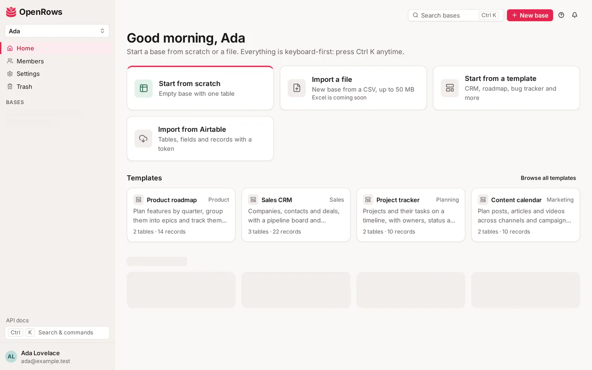
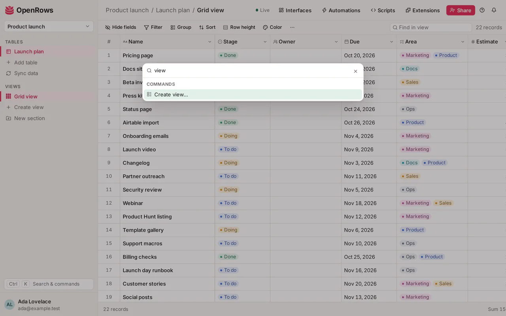

# Getting started

Sign in, find your way around workspaces and bases, create your first base and learn the shortcuts that make OpenRows fast.

## Sign in

Open OpenRows in your browser and pick one of the buttons on the sign-in page:

- **Sign in** if you already have an account.
- **Create account** to sign up.
- **Continue with Google**, **Continue with GitHub** (or another provider) when the server offers them.

OpenRows needs a verified email address. If you see "Please verify your email address first", open the confirmation email, then sign in again.

To sign out, open the account menu at the bottom of the sidebar and choose **Sign out**, or use the button in **Settings**.

## Workspaces

A workspace holds bases and the people who work on them. The first time you sign in, OpenRows creates a personal workspace for you, named after you (for example "Ada's workspace"), and makes you its owner.

The workspace switcher at the top of the sidebar lists every workspace you belong to. From it you can also open:

- **Members**: who is in the workspace, pending invitations and **Invite people**. See [Sharing and permissions](sharing.md).
- **Usage and plan**: what the workspace uses. On the hosted service, your plan's limits apply (see https://openrows.io/pricing); self-hosted instances have no limits.
- **Billing**: owners only, on the hosted service.
- **New workspace**: create another workspace, which you own.

When someone invites you, the email links to an invitation page. Choose **Accept invitation** to join the workspace or base. If you were invited to a single base, the workspace shows under "Bases shared with you" and you see only that base.

## The home page

Home greets you and shows the ways to start a base, then every base you can open, grouped by workspace. Each workspace heading links to that workspace's own page. Creators and owners also see **Trash** and **New base** next to the heading.

The top bar has **Search bases** (opens the command palette), **New base** and the notification bell.

## Create a base

A base is a set of related tables, like a spreadsheet file that knows what each column holds. You need the creator or owner role in a workspace to create bases there.

### Start from scratch

Choose **Start from scratch** (or **New base**), give the base a name and choose **Create base**. The base opens with one table, "Table 1", that has three fields: Name, Notes and Status (Todo, In progress, Done), and a grid view.

### Import a file

Choose **Import a file** and pick a CSV file (comma, semicolon, tab or pipe separated) of up to 50 MB. OpenRows creates a base named after the file and opens the import dialog, where you choose a field type for each column. Details are in [Bases, tables and records](bases-and-tables.md#csv-import). Excel files aren't supported yet.

### Import from Airtable

Choose **Import from Airtable**, paste an Airtable personal access token with the `data.records:read` and `schema.bases:read` scopes, choose **Find bases**, tick the bases you want and start the import. Each Airtable base becomes a new base with its tables, fields, records, linked records, attachments, and grid and kanban views. The token is used only for that import and deleted when it ends. See [Moving from Airtable](airtable-migration.md).

### The demo base

The "Product Roadmap (demo)" workspace holds a sample base with five tables (Features, Epics, Releases, Customer feedback and Team) and 2,000 records. It is added by the person who runs your OpenRows server, not from the app; see [Self-hosting](self-hosting.md).

## The app shell

Inside a base, the sidebar shows:

- The base menu (click the base name): **All bases**, **Trash**, **Duplicate base**, **Snapshots**, **Webhooks**, **Export base (ZIP)** and **Delete base**. Which items you see depends on your role.
- **Tables**: click to open a table; double-click to rename it. The "..." menu on a table has **Rename**, **Move up**, **Move down**, **Edit permissions** and **Delete table**. **Add table** adds a new one.
- **Views**: the views of the open table, grouped by section, with your personal views apart. See [Views](views.md).

The top bar shows where you are (base / table / view), the avatars of others on the same view, a live-updates indicator ("Live", "Reconnecting…" or "Offline"), **Automations** and **Share**.

Changes made by others appear as they happen. If the connection drops, a banner says so and the view catches up when you are back online.

On narrow screens the sidebar becomes a drawer: tap the menu button in the top bar to open it. On medium screens it collapses to a rail of icons.

## Command palette

Press **Ctrl K** (**Cmd K** on a Mac) anywhere, or click **Search & commands** in the sidebar. Type to filter, then press Enter. The palette lists:

- **Tables** of the open base and **Bases** you can open.
- **Create view…** (on a table, for editors and up): pick a view type, and turn on **Only me (personal view)** for a personal one. Backspace in the empty search goes back.
- **Create a base**, **Go to home**, **Settings**, and **Switch to dark mode** or **Switch to light mode**.

## Keyboard basics

| Keys | What they do |
| --- | --- |
| Ctrl/Cmd K | Open or close the command palette |
| Arrow keys, Tab, Shift+Tab | Move between cells in the grid |
| Ctrl/Cmd + arrow | Jump to the first or last row or column |
| Home, End, Page Up, Page Down | First or last column, one screen up or down |
| Shift + arrow or click | Extend the selection |
| Enter or F2 | Edit the selected cell (or just start typing) |
| Esc | Cancel an edit |
| Delete or Backspace | Clear the selected cells |
| Space | Expand the selected record |
| Ctrl/Cmd C, X, V | Copy, cut and paste cells |
| Ctrl/Cmd D | Fill down |
| Ctrl/Cmd Z, Ctrl/Cmd Shift Z or Ctrl/Cmd Y | Undo, redo |
| Ctrl/Cmd F | Find in the view |
| Up/Down or J/K | Previous or next record in the expanded record |
| Ctrl/Cmd Enter | Send a comment |

More in [Bases, tables and records](bases-and-tables.md#edit-in-the-grid).

## Dark mode

OpenRows follows your system's light or dark setting. To choose yourself, open **Settings** and pick **System**, **Light** or **Dark** under **Appearance**. The account menu and the command palette also switch between light and dark mode. The choice is stored in your browser.

## Settings

Open **Settings** from the sidebar or the account menu. It has:

- **Account**: your name and email, and **Sign out**.
- **Appearance**: the theme.
- **Email notifications**: what is emailed and when (see below).
- **Your data**: **Export my data** downloads a ZIP of your profile, memberships, the comments you wrote and every base of the workspaces you own.
- **Developer: personal access tokens**: tokens for scripts and integrations that call the [REST API](../api/v1.md) or the [MCP](../api/mcp.md) endpoint as you. **Create token** lets you limit a token to scopes and to chosen workspaces and bases; the token is shown once.
- **Delete account**.

## Notifications

The bell in the top bar shows a count of unread notifications. You get one when someone:

- mentions you in a comment,
- replies on a record you commented on,
- adds you to a user field that notifies.

Click a notification to open the record (at the comment, for mentions and replies). **Mark all as read** clears the count. Notifications older than 90 days are removed.

Under **Settings**, **Email notifications** sets **What** is emailed (**All notifications**, **Only mentions** or **Nothing**) and **When** (**Right away**, **Hourly digest** or **Daily digest**). Right away sends at most one email per record every 10 minutes. The bell always shows everything, whatever you choose for email. Notification emails have a one-click unsubscribe link.

## Trash

Deleting a base, table, field, view or record moves it to the trash, where it stays for 30 days before it is removed for good.

- **Deleted bases**: the **Trash** button on Home (next to the workspace) or in the sidebar, for creators and owners.
- **Deleted tables, fields, views and records**: **Trash** in the base menu, for editors and up.

Choose **Restore** to bring an item back. Creators and owners can also delete items permanently. See [Bases, tables and records](bases-and-tables.md#trash-and-restore).

## Snapshots

A snapshot is a point-in-time copy of a whole base. OpenRows takes one every day for bases that changed, and you can take one any time with **Snapshot now** in the base menu's **Snapshots** dialog (creators and owners). Restoring a snapshot makes a new base and leaves the original alone. See [Bases, tables and records](bases-and-tables.md#base-snapshots).

## Install the app and work offline

OpenRows can be installed as an app from the browser: **Install OpenRows** in Chrome or Edge's address bar or menu, or **Share → Add to Home Screen** on an iPhone or iPad. It opens in its own window with the rose icon.

Pages you open while online are kept on your device, so when the connection drops you can still read the views you visited last. A banner says **Offline, read-only**: editing comes back as soon as you're online again. Only your own data is kept, and signing out deletes it from the device, so sign out on a shared computer.

On a phone, swipe right from the left edge of the screen (or tap the menu button) to open the sidebar, and tap a record to open it full screen.

## Next steps

- [Bases, tables and records](bases-and-tables.md)
- [Fields](fields.md)
- [Views](views.md)
- [Sharing and permissions](sharing.md)
- [Forms](forms.md)
- [Automations](automations.md)
